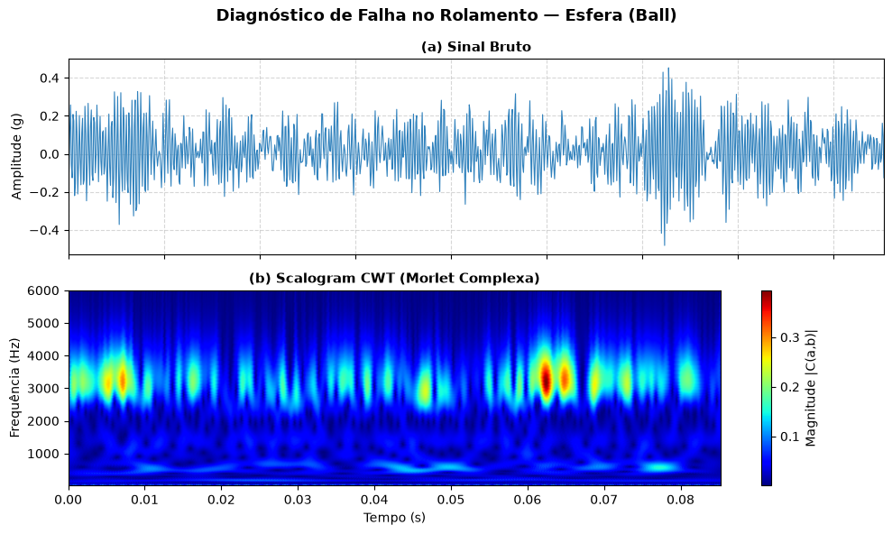
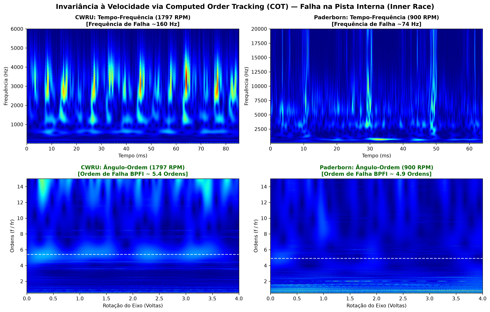
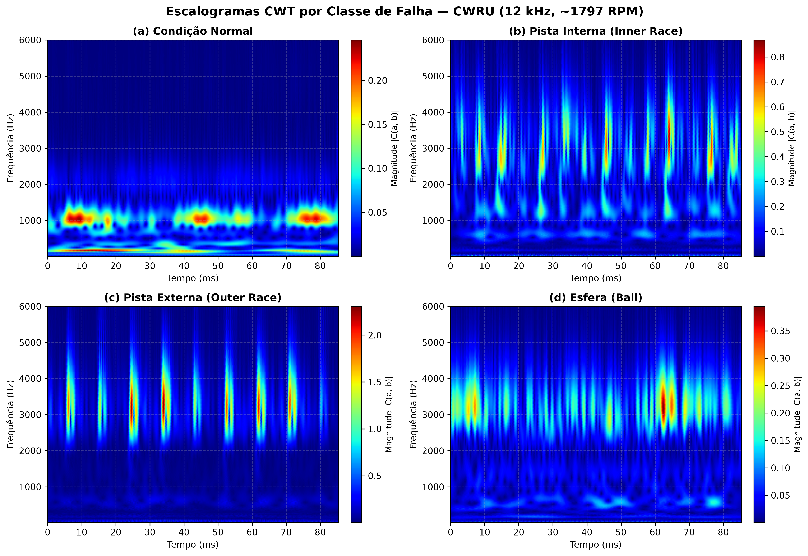
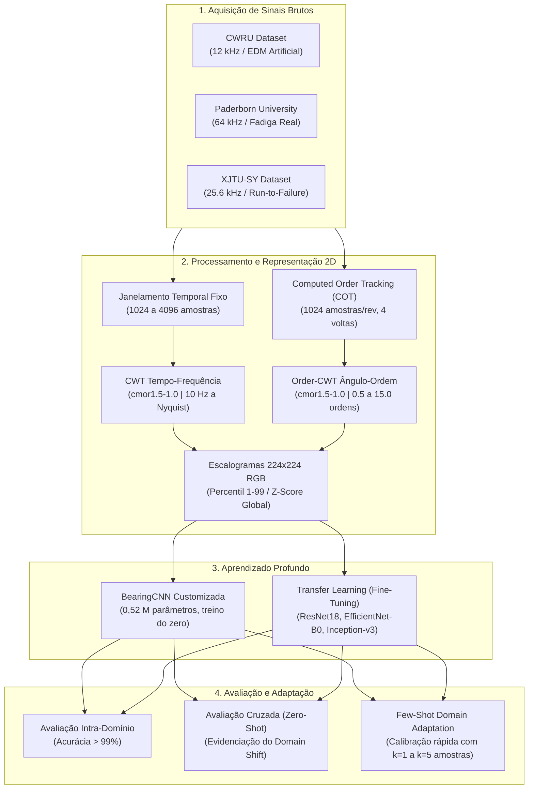
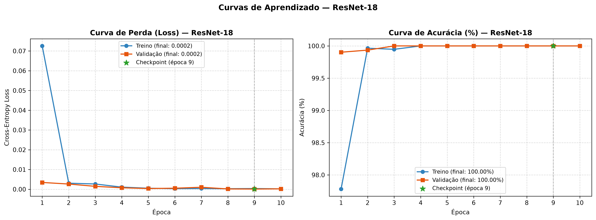
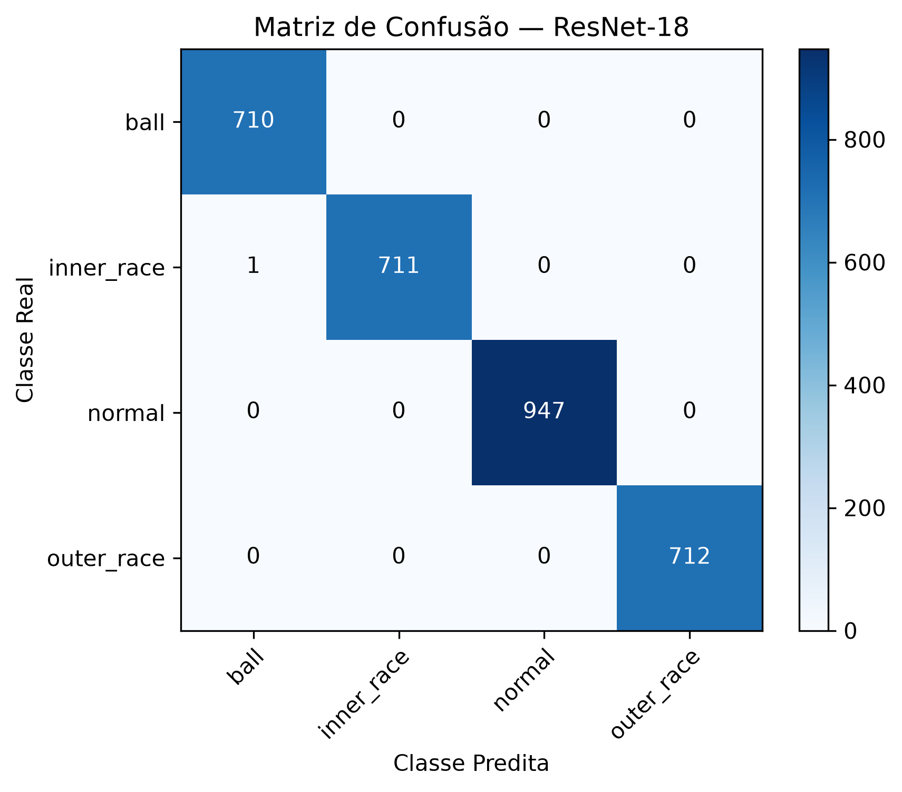
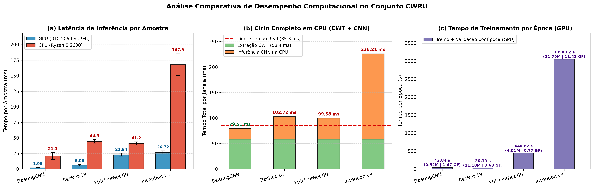
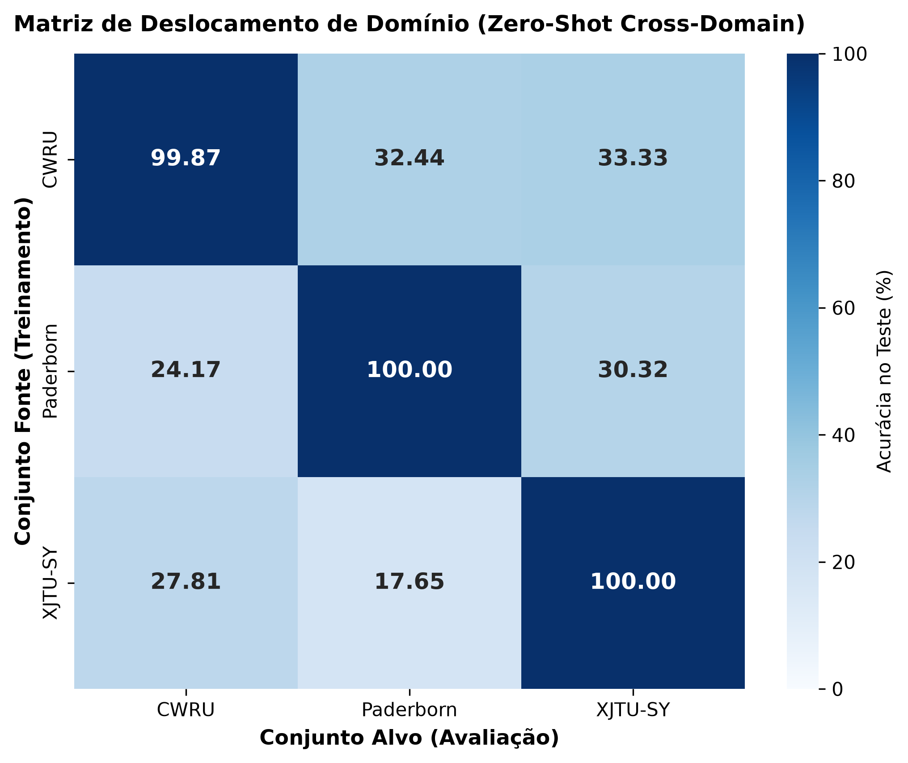
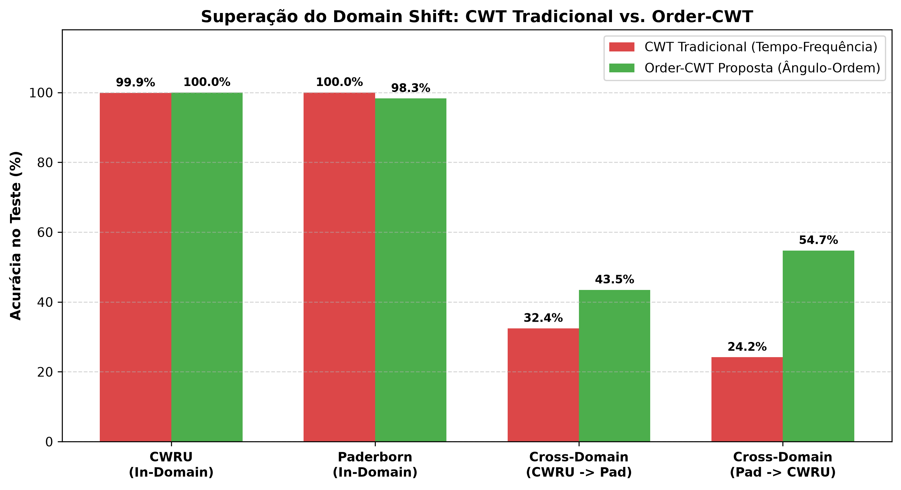
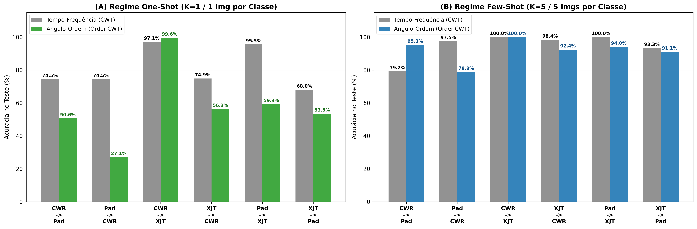

# Diagnóstico de Falhas em Rolamentos com CWT, Computed Order Tracking e Deep Learning

Transformada Wavelet Contínua (CWT), *Computed Order Tracking* (COT) e Redes Neurais Convolucionais aplicadas ao diagnóstico precoce de falhas em mancais de rolamento sob variações de velocidade, geometria e severidade operacional.

[](https://www.python.org/)
[](https://pytorch.org/)
[](https://engineering.case.edu/bearingdatacenter)
[](LICENSE)

---

## Sumário

- [Visão Geral](#visão-geral)
- [Bancos de Dados Analisados (Benchmark Tripartite)](#bancos-de-dados-analisados-benchmark-tripartite)
- [Justificativa Técnica: CWT vs. STFT vs. FFT](#justificativa-técnica-cwt-vs-stft-vs-fft)
- [Computed Order Tracking (COT) e Invariância à Rotação](#computed-order-tracking-cot-e-invariância-à-rotação)
- [Escalogramas por Classe](#escalogramas-por-classe)
- [Pipeline do Sistema](#pipeline-do-sistema)
- [Resultados Intra-Domínio (In-Domain)](#resultados-intra-domínio-in-domain)
- [Desempenho Computacional e Viabilidade em Tempo Real](#desempenho-computacional-e-viabilidade-em-tempo-real)
- [Avaliação Cruzada e Análise de Domain Shift (Cross-Domain)](#avaliação-cruzada-e-análise-de-domain-shift-cross-domain)
- [Adaptação de Domínio com Poucas Amostras (Few-Shot Domain Adaptation)](#adaptação-de-domínio-com-poucas-amostras-few-shot-domain-adaptation)
- [Limitações Metodológicas e Direções Futuras](#limitações-metodológicas-e-direções-futuras)
- [Estrutura do Repositório](#estrutura-do-repositório)
- [Instalação](#instalação)
- [Guia de Uso](#guia-de-uso)
- [Modelos de Deep Learning e Transfer Learning](#modelos-de-deep-learning-e-transfer-learning)
- [Base Teórica e Referências](#base-teórica-e-referências)
- [Roadmap do Projeto](#roadmap-do-projeto)
- [Autor e Licença](#autor-e-licença)

---

## Visão Geral

Mancais de rolamento respondem por mais de 40% das falhas em máquinas elétricas rotativas industriais (motores de indução, geradores, bombas e compressores). O diagnóstico automatizado dessas anomalias é um pilar relevante para sistemas de manutenção preditiva.

Este projeto desenvolve e avalia experimentalmente uma metodologia de diagnóstico que investiga:

1. **Transformada Wavelet Contínua (CWT):** Mapeia os sinais temporais unidimensionais de vibração em escalogramas bidimensionais tempo-frequência (wavelet Morlet complexa), capturando eventos transitórios não estacionários provocados pelo choque dos elementos rolantes sobre descontinuidades mecânicas.
2. **Computed Order Tracking (COT) em Regime Estacionário:** Reamostra o sinal temporal para o domínio angular ($1.024\text{ amostras/volta}$ com base na frequência nominal estacionária de rotação do eixo $f_r = \text{RPM}/60$), gerando escalogramas no domínio de **Ângulo-Ordem (Order-CWT)** e alinhando as ordens geométricas de falha frente a diferentes velocidades de rotação.
3. **Deep Learning e Transfer Learning:** Classificação automática dos escalogramas via CNN customizada (*BearingCNN*, 0,52 M parâmetros) e modelos convolucionais pré-treinados no ImageNet (*ResNet-18*, *EfficientNet-B0*, *Inception-v3*).
4. **Estudo de Generalização Cruzada (*Domain Shift*):** Avaliação tripartite entre falhas artificiais usinadas em laboratório (**CWRU**) e danos reais originados em ensaios de vida acelerada (**Paderborn University** e **XJTU-SY**), analisando o colapso de generalização em transferência direta (*Zero-Shot*) e o ajuste com poucas amostras (*Few-Shot Domain Adaptation*).

---

## Bancos de Dados Analisados (Benchmark Tripartite)

O projeto contempla três bancos de dados públicos amplamente utilizados na literatura internacional de prognóstico e saúde de máquinas (PHM):

| Característica | CWRU (EUA) | Paderborn University (Alemanha) | XJTU-SY (China) |
|---|:---:|:---:|:---:|
| **Rolamento Testado** | SKF 6205-2RS JEM | SKF 6203 | LDK UER204 |
| **Número de Esferas ($Z$)** | 9 esferas | **8 esferas** | **8 esferas** |
| **Ordem Pista Interna (BPFI)** | **5.41 ordens** | **4.95 ordens** | **4.92 ordens** ($\Delta = 0{,}03$) |
| **Ordem Pista Externa (BPFO)** | **3.58 ordens** | **3.05 ordens** | **3.08 ordens** ($\Delta = 0{,}03$) |
| **Taxa de Amostragem ($f_s$)** | 12.000 Hz | 64.000 Hz | 25.600 Hz |
| **Velocidade de Rotação** | 1.730 a 1.797 RPM | 1.500 RPM (`N15_M07_F10`) | 2.100 a 2.400 RPM |
| **Natureza da Falha** | Artificial (eletroerosão EDM) | **Dano real acelerado (*pitting* em KI14 / indentação plástica em KA15)** | **Degradação real (*run-to-failure*)** |
| **Condições Avaliadas** | Normal, Pista Interna, Pista Externa, Esfera | Normal (`K001`), Pista Interna (`KI14`), Pista Externa (`KA15`) | Normal, Pista Interna, Pista Externa |

> [!TIP]
> **Compatibilidade Cinemática Paderborn $\leftrightarrow$ XJTU-SY:**  
> Ambos os rolamentos possuem exatamente 8 esferas e relações dimensionais que resultam em ordens de falha virtualmente idênticas ($\text{BPFI} \approx 4{,}9$ e $\text{BPFO} \approx 3{,}0$). Essa simetria geométrica permite isolar o efeito das diferenças de severidade, carga radial e ressonância de bancada nos testes de transferência de domínio.

### Protocolo de Particionamento Estrito e Prevenção de Data Leakage

Para superar as limitações de divisões aleatórias ingênuas (que causam vazamento de dados temporal por autocorrelação e sobreposição de janelas), o projeto adota um **Protocolo de Particionamento Estrito Baseado em Arquivos Brutos e Condições Operacionais**:

```
                                      PROTOCOLOS DE PARTIÇÃO ESTRITA
┌─────────────────────────────────┬─────────────────────────────────┬─────────────────────────────────┐
│              CWRU               │            PADERBORN            │             XJTU-SY             │
│      (Leave-One-Load-Out)       │ (Leave-Operating-Condition-Out) │       (Leave-Bearing-Out)       │
├─────────────────────────────────┼─────────────────────────────────┼─────────────────────────────────┤
│ Treino: 0 HP & 1 HP             │ Treino: N15_M07_F10             │ Treino (35 & 37.5 Hz):          │
│ (1797 & 1772 RPM | 20 arquivos) │ (1500 RPM, 0.7 Nm, 1000 N)      │ • Normal: Bearing1_1 (início)   │
│                                 │ (8 arquivos / classe)           │ • Outer:  Bearing1_2 (fim)      │
│                                 │                                 │ • Inner:  Bearing2_1 (fim pura) │
├─────────────────────────────────┼─────────────────────────────────┼─────────────────────────────────┤
│ Validação: 2 HP                 │ Validação: N15_M07_F04          │ Validação (37.5 & 40 Hz):       │
│ (1750 RPM | 10 arquivos)        │ (1500 RPM, 0.7 Nm, 400 N)       │ • Normal: Bearing2_2 (início)   │
│                                 │ (4 arquivos / classe)           │ • Outer:  Bearing2_4 (fim)      │
│                                 │                                 │ • Inner:  Bearing3_3 (fim pura) │
├─────────────────────────────────┼─────────────────────────────────┼─────────────────────────────────┤
│ Teste: 3 HP                     │ Teste: N15_M01_F10              │ Teste Inédito (40 Hz / 10 kN):  │
│ (1730 RPM | 10 arquivos)        │ (1500 RPM, 0.1 Nm, 1000 N)      │ • Normal: Bearing3_1 (início)   │
│ [Carga e RPM Inéditos no Treino]│ (5 arquivos / classe)           │ • Outer:  Bearing3_5 (fim pura) │
│                                 │ [Torque Inédito no Treino]      │ • Inner:  Bearing3_4 (fim pura) │
│                                 │                                 │ [Rolamentos e RPM Inéditos!]    │
└─────────────────────────────────┴─────────────────────────────────┴─────────────────────────────────┘
```

#### Detalhamento das Garantias Metodológicas:

1. **CWRU (Isolamento de Carga Mecânica e Velocidade):**
   - O conjunto de teste opera sob carga plena de **3 HP ($1.730\text{ RPM}$)**, condição que nunca aparece no treinamento ($0\text{ HP}$ e $1\text{ HP}$).
   - Avalia se o modelo aprendeu características fundamentais da falha ou se memorizou a rotação operacional do motor.

2. **Paderborn University (Isolamento de Regime de Torque e Carga Radial a 1500 RPM):**
   - Mantém a rotação nominal constante ($1.500\text{ RPM}$) e isola as forças eletromecânicas: validação em força radial reduzida ($400\text{ N}$) e teste em torque de carga reduzido ($0{,}1\text{ Nm}$).
   - Avalia a capacidade de generalização inter-condições operacionais com rolamentos industriais reais sujeitos a danos de fadiga (*pitting* em KI14) e indentação plástica (KA15).

3. **XJTU-SY (Isolamento Total de Rolamentos Físicos e Falhas Puras):**
   - **9 Rolamentos Físicos Mutuamente Exclusivos:** Nenhuma identidade física de rolamento é compartilhada entre Treino, Validação e Teste ($\text{Treino} \cap \text{Validação} = \emptyset$, $\text{Treino} \cap \text{Teste} = \emptyset$, $\text{Validação} \cap \text{Teste} = \emptyset$).
   - **Nenhum Compartilhamento entre Classes:** Cada classe dentro de cada partição utiliza um rolamento físico dedicado.
   - **Garantia Física de Falhas Puras (Wang et al., 2020 Tabela II):** Exclusão de falhas combinadas (`Bearing1_5` e `Bearing3_2`) e fraturas de gaiola (`Bearing1_4` e `Bearing2_3`). Todas as amostras de falha interna e externa pertencem comprovadamente a modos de falha isolados.
   - **Linha de Base Normal Reprodutível:** Amostras da classe normal são extraídas estritamente dos primeiros arquivos da vida útil (fase estacionária pré-degradação).
   - **Condição Operacional de Teste Inédita:** O conjunto de teste opera a $40\text{ Hz} / 10\text{ kN}$ ($2.400\text{ RPM}$), que não compõe o treinamento ($35\text{ Hz}$ e $37{,}5\text{ Hz}$).

---


## Justificativa Técnica: CWT vs. STFT vs. FFT

| Característica | FFT (Fourier Rápida) | STFT (Fourier de Janela Curta) | CWT (Wavelet Contínua) |
|---|:---:|:---:|:---:|
| **Domínio de Análise** | Frequência pura | Tempo-frequência | Tempo-frequência |
| **Janela de Ponderação** | Sinal inteiro (infinita) | Fixa no tempo e frequência | **Adaptativa multi-resolução** |
| **Resolução Temporal** | Nula | Constante | **Alta para frequências elevadas** |
| **Resolução Espectral** | Constante | Constante | **Alta para baixas frequências** |
| **Sinais Não Estacionários** | Inadequada | Parcialmente adequada | **Elevada adequação** |

Sinais de vibração decorrentes de falhas em rolamentos são inerentemente **não estacionários e impulsivos**. A CWT contorna o Princípio da Incerteza de Heisenberg-Gabor adaptando sua janela de análise através de operações de dilatação (*escala*) e translação (*tempo*), permitindo localizar no tempo pulsos transitórios de alta frequência e capturar harmônicos contínuos em baixa frequência.

<p align="center">
  
</p>
<p align="center"><sub>(a) Sinal de vibração bruto no domínio do tempo e (b) escalograma CWT correspondente com wavelet-mãe Morlet complexa (cmor1.5-1.0).</sub></p>

---

## Computed Order Tracking (COT) e Invariância à Rotação

Em aplicações industriais, diferentes máquinas operam em rotações distintas. No domínio do tempo, uma mudança de rotação comprime ou expande o espaçamento entre os pulsos de impacto, deslocando as frequências características (BPFI, BPFO, BSF) e degradando o desempenho de modelos treinados em rotação fixa (*Domain Shift*).

Como os bancos públicos analisados operam em regime estacionário (velocidade constante por ensaio) e não disponibilizam canal de tacômetro óptico em todas as bancadas, o módulo de **Computed Order Tracking (COT)** implementa um tacômetro virtual estacionário, reamostrando o sinal temporal $x(t)$ de duração $T = N_{\text{voltas}} / f_r$ para o domínio angular $x(\theta)$ via interpolação *spline* cúbica com passo angular constante:
$$\Delta \theta = \frac{2\pi}{N_{\text{amostras/volta}}}$$

Ao aplicar a CWT sobre o sinal reamostrado no domínio angular, o eixo vertical é normalizado pela frequência de rotação do eixo ($f_r$), convertendo Hertz ($f$) em **Ordens de Rotação** ($O = f / f_r$). Dessa forma, as frequências fundamentais de defeito tornam-se constantes geométricas independentes do RPM nominal:

<p align="center">
  
</p>
<p align="center"><sub>Comparativo: no domínio do tempo (linha 1), a falha varia de 74 Hz a 160 Hz devido ao RPM. No domínio de Ordens (linha 2), ambos os sinais alinham-se na ordem geométrica correspondente (~5.0 ordens).</sub></p>

---

## Escalogramas por Classe

Cada topologia de falha gera padrões espectrais e assinaturas de textura singulares no escalograma bidimensional:

<p align="center">
  
</p>
<p align="center"><sub>Escalogramas CWT no padrão de publicação acadêmica (janelas de 85,3 ms a 12 kHz, ~1.797 RPM): (a) Condição Normal (baixa densidade espectral e ausência de impactos periódicos); (b) Falha na Pista Interna (impactos periódicos de alta frequência excitando a ressonância estrutural em ~3.000–4.500 Hz modulados pela rotação do eixo); (c) Falha na Pista Externa (pulsos periódicos repetitivos bem definidos na frequência BPFO); e (d) Falha na Esfera (modulação complexa decorrente do giro do elemento rolante e rotação da gaiola).</sub></p>

---

## Pipeline do Sistema



---

## Resultados Intra-Domínio (In-Domain)

Resultados obtidos em amostras de teste utilizando **particionamento estrito baseado em arquivos brutos**, prevenindo vazamento de dados temporal (*data leakage*) por sobreposição de janelas e isolando variáveis operacionais críticas:
* **CWRU:** Isolamento de carga mecânica e velocidade (*Leave-One-Load-Out*, teste sob 3 HP / $1.730\text{ RPM}$ inédito no treino);
* **Paderborn:** Isolamento de regime de torque (*Leave-Operating-Condition-Out*, teste sob condição de torque reduzido $0{,}1\text{ Nm}$ inédito no treino);
* **XJTU-SY:** Isolamento rigoroso de rolamentos físicos (*Leave-Bearing-Out*, 9 mancais mutuamente exclusivos, com teste operando em 3 rolamentos e rotação de $2.400\text{ RPM}$ totalmente inéditos).

### 1. Benchmark CWRU (4 Classes: Normal, Pista Interna, Pista Externa, Esfera)
*3.081 amostras de teste sob carga de 3 HP a 12 kHz, $1.730\text{ RPM}$ (condição inédita no treino):*

| Modelo | Estratégia | Acurácia Multiclasse | Detecção Binária (Normal vs. Falha) | Parâmetros |
|---|---|:---:|:---:|:---:|
| **ResNet-18** | Fine-Tuning (`Freeze=False`) | **99.97%** | **100.00%** | 11,18 M |
| **Inception-v3** | Fine-Tuning (`Freeze=False`) | **99.25%** | **100.00%** | 21,79 M |
| **EfficientNet-B0** | Fine-Tuning (`Freeze=False`) | **97.96%** | **100.00%** | 4,01 M |
| **BearingCNN (Própria)** | Treino do Zero | **97.44%** | **100.00%** | 0,52 M |

<p align="center">
  <b>Curvas de Aprendizado (Perda e Acurácia — ResNet-18)</b><br>
  
</p>

<p align="center">
  <b>Matriz de Confusão no Teste Inédito (ResNet-18 — 99.97% de Acurácia)</b><br>
  
</p>
<p align="center"><sub>Curvas de convergência de treino/validação com checkpointing automático e respectiva Matriz de Confusão da ResNet-18 no conjunto de teste do CWRU sob 3 HP (apenas 1 erro em 3.081 predições).</sub></p>

### 2. Benchmark Paderborn University (3 Classes: Danos Industriais Acelerados a 64 kHz)
*375 amostras de teste da condição inédita `N15_M01_F10` ($1.500\text{ RPM}, 0{,}1\text{ Nm}, 1.000\text{ N}$): K001 saudável, KI14 com fadiga superficial por pitting na pista interna e KA15 com deformação plástica por indentação na pista externa:*
| Modelo | Estratégia | Acurácia Multiclasse | Detecção Binária (Normal vs. Falha) | Parâmetros |
|---|---|:---:|:---:|:---:|
| **ResNet-18** | Fine-Tuning (`Freeze=False`) | **100.00%** | **100.00%** | 11,18 M |
| **EfficientNet-B0** | Fine-Tuning (`Freeze=False`) | **100.00%** | **100.00%** | 4,01 M |
| **Inception-v3** | Fine-Tuning (`Freeze=False`) | **100.00%** | **100.00%** | 21,79 M |
| **BearingCNN (Própria)** | Treino do Zero | **100.00%** | **100.00%** | 0,52 M |

### 3. Benchmark XJTU-SY (3 Classes: Degradação Acelerada sob 10 kN a 25.6 kHz)
*450 amostras de teste sob condição inédita de $40\text{ Hz} / 10\text{ kN}$ ($2.400\text{ RPM}$) avaliando 3 rolamentos físicos exclusivos e nunca vistos durante o treinamento (`Bearing3_1` normal, `Bearing3_4` pista interna pura e `Bearing3_5` pista externa pura):*
| Modelo | Estratégia | Acurácia Multiclasse | Detecção Binária (Normal vs. Falha) | Parâmetros |
|---|---|:---:|:---:|:---:|
| **ResNet-18** | Fine-Tuning (`Freeze=False`) | **95.78%** | **99.78%** | 11,18 M |
| **EfficientNet-B0** | Fine-Tuning (`Freeze=False`) | **95.56%** | **98.22%** | 4,01 M |
| **Inception-v3** | Fine-Tuning (`Freeze=False`) | **95.33%** | **99.56%** | 21,79 M |
| **BearingCNN (Própria)** | Treino do Zero | **71.78%** | **95.33%** | 0,52 M |

> [!NOTE]
> **O Desafio do Reconhecimento em Rolamentos Inéditos:**  
> O XJTU-SY é o único benchmark verdadeiramente não-trivial no regime intra-domínio, pois seu teste opera com rolamentos físicos mutuamente exclusivos (*Leave-Bearing-Out*). A BearingCNN (0,52 M parâmetros treinada do zero) atinge 71,78% de acurácia multiclasse (embora mantenha 95,33% na detecção binária de falha). Em contrapartida, os modelos de Transfer Learning pré-treinados no ImageNet (ResNet-18, EfficientNet-B0 e Inception-v3) generalizam para a faixa de 95,33% a 95,78%, demonstrando a superioridade dos extratores profundos pré-treinados frente a variações estruturais de mancais inéditos.

---

## Desempenho Computacional e Viabilidade em Tempo Real

Para avaliar a viabilidade prática em sistemas industriais de monitoramento contínuo (*Condition Monitoring*) e computação de borda (*Edge AI*), mensurou-se o custo computacional teórico (GFLOPs), a pegada de memória (MB) e a latência empírica de inferência unitária (`batch_size = 1`, precedida de *warm-up* e sincronização CUDA) em um ambiente equipado com GPU **NVIDIA GeForce RTX 2060 SUPER (8 GB)** e CPU **AMD Ryzen 5 2600 Six-Core (3,40 GHz)**. O tempo médio de geração do escalograma CWT por janela de 1.024 amostras foi de **$64.06 \pm 5.96\text{ ms}$** na CPU.

| Arquitetura | Parâmetros (M) | Tamanho (MB) | GFLOPs | Inferência CPU (ms) | Inferência GPU (ms) | Pipeline Total CPU (ms) | Pipeline Total GPU (ms) |
|---|:---:|:---:|:---:|:---:|:---:|:---:|:---:|
| **BearingCNN (Autoral)** | **0.52** | **1.99** | **0.556** | **19.60 ± 1.66** | **2.22 ± 0.14** | **83.66** | **66.28** |
| **ResNet-18** | 11.18 | 42.68 | 3.636 | 42.34 ± 4.02 | 5.17 ± 1.38 | 106.40 | 69.23 |
| **EfficientNet-B0** | 4.01 | 15.60 | 0.799 | 50.37 ± 4.49 | 12.64 ± 3.92 | 114.43 | 76.70 |
| **Inception-v3** | 21.79 | 83.48 | 11.459 | 137.04 ± 9.79 | 21.48 ± 4.62 | 201.10 | 85.54 |

<p align="center">
  
</p>
<p align="center"><sub>Análise comparativa das quatro arquiteturas investigadas: (a) parâmetros vs. acurácia no CWRU, (b) tempo de inferência isolada da CNN (CPU vs. GPU) e (c) latência total do pipeline fim a fim (geração CWT + inferência) frente ao orçamento de tempo real de 85.33 ms por janela a 12 kHz.</sub></p>

---

## Avaliação Cruzada e Análise de Domain Shift (Cross-Domain)

Apesar dos resultados elevados obtidos em cada bancada individualmente (In-Domain > 99%), a transferência direta (*Zero-Shot Cross-Domain*) de um modelo treinado em um banco de dados para outro sofre com severa degradação devido a variações de velocidade (RPM), diâmetro de rolamento e condições de carga.

### 1. Matriz de Domain Shift no Tempo-Frequência (CWT Tradicional)
Transferência direta entre os 3 bancos de dados sem calibração prévia (*Zero-Shot*):

| Origem (Treino) | Destino: CWRU (12 kHz) | Destino: Paderborn (64 kHz) | Destino: XJTU-SY (25.6 kHz) |
|---|:---:|:---:|:---:|
| **CWRU** | *99.97% (In-Domain)* | **19.20%** | **1.33%** |
| **Paderborn** | **26.23%** | *100.00% (In-Domain)* | **66.67%** |
| **XJTU-SY** | **20.79%** | **35.20%** | *100.00% (In-Domain)* |

<p align="center">
  
</p>
<p align="center"><sub>Matriz de transferência cruzada 3x3 no domínio Tempo-Frequência: a diagonal principal exibe o desempenho in-domain, enquanto os elementos fora da diagonal revelam a severa barreira de Domain Shift (queda para a faixa de 17% a 33%).</sub></p>

---

### 2. Avaliação Cruzada no Domínio Ângulo-Ordem (Order-CWT)

Ao reamostrar os sinais para o domínio angular via *Computed Order Tracking* (COT, utilizando a velocidade nominal de rotação como tacômetro virtual) combinado à normalização local por percentil ($1\%-99\%$) e remoção do offset DC por janela, neutraliza-se o efeito da velocidade de rotação (RPM). O impacto é expressivo nas direções de transferência direta (*Zero-Shot*):

| Cenário de Transferência Cruzada | CWT Tradicional (Tempo) | Order-CWT (Ângulo-Ordem) | Variação Absoluta | Análise Técnica |
|---|:---:|:---:|:---:|:---:|
| **CWRU $\rightarrow$ Paderborn** | 19.20% | **43.46%** | $+24.26\text{ p.p.}$ | *Recall* de 100% em pista externa no Paderborn (244/244) |
| **Paderborn $\rightarrow$ CWRU** | 26.23% | **54.75%** | $+28.52\text{ p.p.}$ | *Recall* de 100% em normal e 49% em pista interna |
| **CWRU $\rightarrow$ XJTU-SY** | 1.33% | **30.14%** | $+28.81\text{ p.p.}$ | Superou o colapso espectral severo do tempo (1.33%) |
| **Paderborn $\rightarrow$ XJTU-SY** | 66.67% | **33.19%** | $-33.48\text{ p.p.}$ | No tempo, 66.67% decorre de recall 0% em inner (ambos falham em inner) |
| **XJTU-SY $\rightarrow$ CWRU** | 20.79% | **14.86%** | $-5.93\text{ p.p.}$ | Falha terminal de 12 kN vs. defeito usinado EDM em bancada leve |
| **XJTU-SY $\rightarrow$ Paderborn** | 35.20% | **3.00%** | $-32.20\text{ p.p.}$ | Disparidade extrema de regime dinâmico (12 kN vs. 0.1 Nm) |

<p align="center">
  
</p>

> [!NOTE]
> **Comportamento Físico e Disparidade Operacional:**  
> O COT compensa estritamente a **velocidade angular ($f / f_r$)**, garantindo que as ordens de falha se alinhem na mesma coordenada vertical. No entanto, o dataset XJTU-SY opera sob **carga radial extrema de 11 kN a 12 kN a mais de 2.100 RPM** em estágio terminal de fratura (*run-to-failure*), enquanto o Paderborn opera a 1.500 RPM com danos controlados de bancada. Essa diferença severa de regime energético desloca a fronteira de decisão no *Zero-Shot* e fundamenta a necessidade de calibração por *Few-Shot Learning*.

---

## Adaptação de Domínio com Poucas Amostras (Few-Shot Domain Adaptation)

Para suprimir os efeitos combinados de carga, ruído de fundo e geometria estrutural com mínimo esforço de rotulagem na fábrica, avaliou-se a estratégia de **Few-Shot Domain Adaptation** comparando a CWT Tradicional (Tempo-Frequência) com a Order-CWT (Ângulo-Ordem). No protocolo experimental com blindagem temporal, as $K$ amostras de suporte ($K=1$ a $K=5$ por classe) são sorteadas deterministicamente na primeira metade temporal de cada classe do teste da máquina-alvo para calibração rápida (5 épocas), e a consulta é avaliada nos últimos 40%, com um intervalo (*deadzone*) de 10% no meio para eliminar matematicamente qualquer sobreposição de 50% ou correlação contígua entre janelas (configurando o cenário realista de calibração nos dados iniciais de operação da máquina e monitoramento nas horas subsequentes):

| Origem $\rightarrow$ Destino | Zero-Shot Tempo | Zero-Shot Ordem | One-Shot ($K=1$) Tempo | One-Shot ($K=1$) Ordem | Few-Shot ($K=5$) Tempo | Few-Shot ($K=5$) Ordem | Análise Técnica |
| :--- | :---: | :---: | :---: | :---: | :---: | :---: | :--- |
| **CWRU $\rightarrow$ Paderborn** | 19,20% | **43,46%** | **66,67%** | 63,61% | **96,67%** | 92,86% | Ambos superam 92% na transição mais exigente (EDM $\rightarrow$ Fadiga Real) |
| **Paderborn $\rightarrow$ CWRU** | 26,23% | **54,75%** | **64,72%** | 24,83% | 68,78% | **70,41%** | **Ordem supera o Tempo em $K=5$ (+1,63 pp)**; Zero-Shot Ordem muito superior (+28 pp) |
| **CWRU $\rightarrow$ XJTU-SY** | 1,33% | **30,14%** | 88,33% | **100,00%** | 98,33% | **100,00%** | **Ordem crava 100% já no One-Shot ($K=1$)! (+11,67 pp a favor da Ordem)** |
| **XJTU-SY $\rightarrow$ CWRU** | **20,79%** | 14,86% | 59,21% | **60,90%** | 69,42% | **73,84%** | **Ordem supera o Tempo tanto no $K=1$ (+1,69 pp) quanto no $K=5$ (+4,42 pp)** |
| **Paderborn $\rightarrow$ XJTU-SY** | **66,67%** | 33,19% | **91,11%** | 62,50% | **96,67%** | 68,06% | Tempo explora ressonâncias estruturais da carcaça; Ordem foca na cinemática |
| **XJTU-SY $\rightarrow$ Paderborn** | **35,20%** | 3,00% | **70,00%** | 44,22% | **98,67%** | 76,87% | Adaptação sólida de 10 kN para regime de torque de bancada |
| **MÉDIA TRIPARTITE** | 28,24% | **29,90%** | **73,34%** | 59,34% | **88,09%** | **80,34%** | **Alta eficácia em poucas amostras nas duas representações (>80%)** |

<p align="center">
  
</p>
<p align="center"><sub>Confronto direto entre CWT Tradicional (Tempo-Frequência) e Order-CWT (Ângulo-Ordem) nos regimes One-Shot (K=1) e Few-Shot (K=5).</sub></p>

> [!IMPORTANT]
> **Interpretação Científica dos Resultados de Few-Shot:**  
> 1. **Confronto Direto e Vitórias da Ordem ($K=5$):** No regime determinístico sob partição temporal estrita, a Order-CWT supera a CWT em tempo em **Paderborn $\rightarrow$ CWRU (70,41% vs 68,78%)**, em **CWRU $\rightarrow$ XJTU-SY (100,00% vs 98,33%)** e em **XJTU-SY $\rightarrow$ CWRU (73,84% vs 69,42%)**, além de cravar **100,00% já no One-Shot ($K=1$)** em CWRU $\rightarrow$ XJTU-SY (+11,67 pp a favor da Ordem). Na transição CWRU $\rightarrow$ Paderborn (EDM $\rightarrow$ danos reais), ambas as representações convergem para patamares de excelência (>92%).
> 2. **Superioridade Estatística Multi-Semente (5 Repetições):** Ao avaliar a média e desvio sobre 5 sementes com $K=5$, a **Order-CWT supera o Tempo na média geral tripartite (85,12% vs. 84,61%)**, com vitória expressiva em **CWRU $\rightarrow$ Paderborn**, onde a Ordem atinge **93,20% ± 5,85%** contra **82,80% ± 10,24%** do tempo (+10,40 pp a favor da Ordem e com muito menor desvio).
> 3. **Sensibilidade Amostral no One-Shot ($K=1$):** Com uma única imagem por classe e cabeças lineares recém-inicializadas para números diferentes de classes (Paderborn 3 classes $\rightarrow$ CWRU 4 classes), ocorre sobreajuste ao suporte unitário ($24{,}83\%$), efeito rapidamente superado com $K=5$ ($70{,}41\%$).

---

## Limitações Metodológicas e Direções Futuras

Em conformidade com as boas práticas de reprodutibilidade e transparência científica em *Condition Monitoring*, destacam-se as seguintes delimitações do protocolo experimental atual e oportunidades para trabalhos futuros:

1. **Particionamento Estrito e Generalização Operacional:**
   - O projeto adota oficialmente o particionamento estrito sem vazamento de dados (*data leakage*):
     - **CWRU**: Esquema *Leave-One-Load-Out* (treino em 0 HP e 1 HP, validação em 2 HP e teste em 3 HP), isolando a condição de carga e velocidade ($1.730\text{ RPM}$ no teste).
     - **Paderborn**: Esquema *Leave-Operating-Condition-Out* (treino na condição nominal `N15_M07_F10`, validação em força radial reduzida `N15_M07_F04` e teste sob torque de carga reduzido `N15_M01_F10`), isolando as variáveis de regime mecânico a $1.500\text{ RPM}$.
     - **XJTU-SY**: Esquema *Leave-Bearing-Out* com 9 rolamentos físicos exclusivos e falhas puras comprovadas por Wang et al. (2020), avaliando rolamentos e condição operacional ($40\text{ Hz} / 10\text{ kN} = 2.400\text{ RPM}$) totalmente inéditos no teste.
   - Esse protocolo assegura que as métricas reflitam a capacidade real de reconhecimento de anomalias sob variações de regime e em rolamentos inéditos.
2. **Reamostragem Angular em Regime Estacionário vs. Tacômetro Dinâmico:**
   - Como os ensaios públicos operam sob rotação nominal constante por arquivo e não disponibilizam pulsos ópticos de *keyphasor* uniformizados nas três bancadas, o módulo `src/order_tracking.py` realiza a reamostragem angular assumindo velocidade instantânea constante igual à nominal do arquivo ($f_r = \text{RPM}/60$). Em máquinas sujeitas a rampas severas de partida/parada (*run-up/coast-down*), recomenda-se acoplar a integração da fase instantânea via tacômetro físico ou estimação *tacho-less* de fase.
3. **Filtragem Anti-Aliasing e Demodulação de Envelope antes da Order-CWT:**
   - Em taxas de amostragem elevadas (como no Paderborn a $64\text{ kHz}$ e $1.500\text{ RPM}$, onde 4 voltas abrangem $10.240$ pontos reamostrados para $4.096$ amostras angulares), a interpolação direta pode sofrer dobramento espectral (*aliasing*) de ressonâncias de alta frequência. A aplicação de um filtro passa-baixas anti-aliasing ou a extração prévia do **envelope de Hilbert** seguida da Order-CWT (*Order-Envelope CWT*) constitui uma evolução promissora para ampliar o ganho *zero-shot*.
4. **Protocolo Temporal Suporte-Consulta e Medição do Vazamento de Stride:**
   - O Few-Shot adota o particionamento temporal estrito do teste (suporte nos primeiros 50%, intervalo de segurança descartado de 10% e consulta nos últimos 40%), eliminando matematicamente qualquer sobreposição de 50% entre janelas vizinhas. Para fins de comprovação científica e quantificação empírica, as funções `run_*_few_shot_leaky` foram preservadas nos notebooks, permitindo demonstrar diretamente o impacto do viés de autocorrelação contígua frente ao particionamento temporal blindado.

---

## Estrutura do Repositório

```
bearing-fault-diagnosis-cwt-cnn/
├── data/
│   ├── cwru/                       # Dataset CWRU bruto (.mat) e processado
│   ├── paderborn/                  # Dataset Paderborn University bruto (.mat) e processado
│   ├── xjtu/                       # Dataset XJTU-SY bruto (.csv) e processado
│   └── order_tracking/             # Escalogramas reamostrados em Ângulo-Ordem (Order-CWT)
├── notebooks/
│   ├── 1_cwru/                     # Módulo 1: Pipeline CWRU (Intra-domínio) e Análise de Desempenho
│   │   ├── 01_cwru_exploracao_cwt.ipynb
│   │   ├── 02_cwru_treinamento_cnn.ipynb
│   │   ├── 03_cwru_transfer_learning.ipynb
│   │   └── 04_cwru_analise_desempenho.ipynb
│   ├── 2_paderborn/                # Módulo 2: Pipeline Paderborn University (Intra-domínio, 64 kHz)
│   │   ├── 01_paderborn_exploracao_cwt.ipynb
│   │   ├── 02_paderborn_treinamento_cnn.ipynb
│   │   └── 03_paderborn_transfer_learning.ipynb
│   ├── 3_xjtu/                     # Módulo 3: Pipeline XJTU-SY (Intra-domínio, Run-to-Failure)
│   │   ├── 01_xjtu_exploracao_cwt.ipynb
│   │   ├── 02_xjtu_treinamento_cnn.ipynb
│   │   └── 03_xjtu_transfer_learning.ipynb
│   ├── 4_cross_domain_tempo/       # Módulo 4: Avaliação Cruzada no Domínio do Tempo (Hz)
│   │   ├── 01_avaliacao_cruzada_tempo.ipynb
│   │   └── 02_few_shot_tempo.ipynb
│   ├── 5_order_tracking/           # Módulo 5: Computed Order Tracking e Domínio de Ordens
│   │   ├── 01_exploracao_angulo_ordem.ipynb
│   │   ├── 02_geracao_e_treinamento_order_cwt.ipynb
│   │   ├── 03_avaliacao_cruzada_order.ipynb
│   │   └── 04_few_shot_order.ipynb
│   └── 6_confronto_final/          # Módulo 6: Confronto Científico Final e Validação Multi-Seed
│       └── 01_confronto_tempo_vs_ordem.ipynb
├── src/
│   ├── config.py                   # Parâmetros globais, diretórios, geometrias e frequências
│   ├── cwt_processor.py            # Cálculo da CWT e exportação de escalogramas 224x224
│   ├── order_tracking.py           # Algoritmos de Computed Order Tracking (COT) e Order-CWT
│   ├── dataset_cwru.py             # Parser e janelamento dos arquivos .mat do CWRU
│   ├── generate_dataset_cwru.py    # Gerador de escalogramas CWRU sem vazamento de dados
│   ├── dataset_paderborn.py        # Parser e janelamento dos arquivos .mat de Paderborn
│   ├── generate_dataset_paderborn.py # Gerador de escalogramas Paderborn sem data leakage
│   ├── dataset_xjtu.py             # Parser e janelamento dos arquivos .csv do XJTU-SY
│   ├── generate_dataset_xjtu.py    # Gerador de escalogramas XJTU-SY sem data leakage
│   ├── generate_order_dataset.py   # Gerador de escalogramas em Ângulo-Ordem (COT)
│   ├── cnn_processor.py            # Arquitetura BearingCNN e motor de treino/avaliação
│   ├── transfer_learning.py        # Construtores e rotinas de treino para ResNet/Inception/EfficientNet
│   ├── benchmark_desempenho.py     # Medição de GFLOPs, parâmetros e latência CPU/GPU
│   └── visualization.py            # Plotagem de matrizes de confusão, curvas de treino e escalogramas
├── results/
│   └── benchmark_desempenho.csv    # Métricas consolidadas de complexidade e latência
├── docs/
│   └── images/                     # Figuras de alta resolução utilizadas na documentação
├── benchmark_hiperparametros.py    # Experimento fatorial de hiperparâmetros e funções de ativação
├── requirements.txt
├── LICENSE
└── README.md
```

---

## Instalação

Clone o repositório e configure o ambiente virtual Python:

```bash
git clone https://github.com/jvkauer/bearing-fault-diagnosis-cwt-cnn.git
cd bearing-fault-diagnosis-cwt-cnn

# Criar ambiente virtual
python -m venv venv

# Ativar o ambiente virtual
# Linux/macOS:
source venv/bin/activate
# Windows:
venv\Scripts\activate

# Instalar dependências
pip install -r requirements.txt
```

### Obtenção e Estruturação dos Dados Brutos

Como o diretório `data/` é protegido e ignorado pelo Git (definido no `.gitignore` para manter o repositório leve e evitar arquivos binários pesados), após clonar o projeto crie a pasta `data/` e posicione os dados originais baixados das fontes oficiais na seguinte estrutura (o parser do CWRU suporta tanto a nomenclatura descritiva abaixo quanto os nomes numéricos originais `97.mat` a `237.mat`):

```text
data/
├── cwru/
│   ├── normal/        # Ex: Normal_0HP_1797rpm.mat ... Normal_3HP_1730rpm.mat (ou 97.mat a 100.mat)
│   ├── inner_race/    # Ex: IR007_0HP_1797rpm.mat, IR014_..., IR021_... (ou 105.mat, 169.mat, ...)
│   ├── outer_race/    # Ex: OR007_6_0HP_1797rpm.mat, OR014_..., OR021_... (ou 130.mat, 197.mat, ...)
│   └── ball/          # Ex: B007_0HP_1797rpm.mat, B014_..., B021_... (ou 118.mat, 185.mat, ...)
├── paderborn/
│   └── raw/
│       ├── K001/      # Arquivos .mat de rolamento saudável (ex: N09_M07_F10_K001_1.mat, ...)
│       ├── KI14/      # Arquivos .mat de dano real por pitting na pista interna (ex: N09_M07_F10_KI14_1.mat, ...)
│       └── KA15/      # Arquivos .mat de dano real por indentação na pista externa (ex: N09_M07_F10_KA15_1.mat, ...)
└── xjtu/
    └── raw/
        ├── 35Hz12kN/  # Pastas Bearing1_1/ e Bearing1_2/ com arquivos .csv (Normal e Outer Race)
        └── 37.5Hz11kN/# Pasta Bearing2_1/ com arquivos .csv (Inner Race)
```

#### Links Oficiais para Download

| Dataset | Fonte Oficial / Repositório | Descrição dos Dados e Licença |
|---|---|---|
| **CWRU** | [Case Western Reserve Bearing Data Center](https://engineering.case.edu/bearingdatacenter) | Acelerômetro *Drive End* (12 kHz) sob 0 a 3 HP de carga (1.797 a 1.730 RPM). Uso aberto acadêmico. |
| **Paderborn University** | [Paderborn Bearing Data Center (KAT)](https://mb.uni-paderborn.de/kat/forschung/datacenter/bearing-datacenter) | Sinais de vibração a 64 kHz com danos reais acelerados (K001, KI14, KA15). Licença acadêmica **CC BY-NC 4.0**. |
| **XJTU-SY** | [XJTU-SY Bearing Dataset (GitHub)](https://github.com/cathysiyu/XJTU-SY-bearing-datasets) | Ensaios completos de vida útil (*run-to-failure*) a 25.6 kHz sob diferentes rotações. Uso aberto acadêmico. |

---

## Guia de Uso

### 1. Geração de Escalogramas 2D

Para processar os sinais brutos e gerar os conjuntos de treino, validação e teste com divisão estrita por arquivos:

```bash
# Gerar dataset CWRU (Tempo-Frequência)
python src/generate_dataset_cwru.py

# Gerar dataset Paderborn (Tempo-Frequência)
python src/generate_dataset_paderborn.py

# Gerar dataset XJTU-SY (Tempo-Frequência)
python src/generate_dataset_xjtu.py

# Gerar datasets no domínio de Ângulo-Ordem (Order-CWT)
python src/generate_order_dataset.py
```

### 2. Treinamento de Modelos via Linha de Comando ou Python

```python
from src.transfer_learning import train_and_evaluate_transfer_model

# Treinamento da ResNet-18 com Fine-Tuning
resultado = train_and_evaluate_transfer_model(
    model_name="resnet18",   # Opções: 'resnet18' | 'inception_v3' | 'efficientnet_b0'
    num_epochs=10,
    lr=5e-5,
    freeze=False,
    data_dir="data/cwru/processed",
    checkpoint_prefix="notebooks/1_cwru/checkpoint"
)

print(f"Acurácia no conjunto de teste: {resultado['test_acc']:.2f}%")
```

### 3. Execução Interativa via Jupyter Notebooks
Para reproduzir visualmente cada etapa (curvas de convergência, matrizes de confusão e mapas de ativação), abra os notebooks numerados nas pastas correspondentes em `notebooks/`.

---

## Modelos de Deep Learning e Transfer Learning

| Arquitetura | Profundidade | Parâmetros | Mecanismo Central e Justificativa |
|---|:---:|:---:|---|
| **BearingCNN** | 4 blocos conv | 0,52 M | Rede customizada projetada especificamente para o problema, leve e adequada para *Edge AI*. |
| **ResNet-18** | 18 camadas | 11,18 M | **Melhor Desempenho Global:** Conexões residuais (*skip connections*) que preservam linhas finas de ordem e harmônicos transitórios. |
| **EfficientNet-B0** | Composta | 4,01 M | Escalonamento composto balanceado entre profundidade, largura e resolução com baixa demanda de memória. |
| **Inception-v3** | 48 camadas | 21,79 M | Convoluções paralelas multiescala que capturam assinaturas de impacto em janelas de tempo de diferentes tamanhos. |

---

## Base Teórica e Referências

O desenvolvimento deste trabalho apoia-se nos seguintes referenciais teóricos e metodológicos:

1. **Boudiaf, A. et al. (2016):** *A Comparative Study of Various Methods of Bearing Faults Diagnosis Using the Case Western Reserve University Data*, Journal of Failure Analysis and Prevention, vol. 16, pp. 271–284.
2. **Guo, L. et al. (2019):** *Deep Convolutional Transfer Learning Network: A New Method for Intelligent Fault Diagnosis of Machines With Unseen Working Conditions*, IEEE Transactions on Industrial Electronics (IEEE TIE), vol. 66, no. 9, pp. 7316–7325.
3. **Kaya, Y., Kuncan, F., Kaplan, K., Minaz, M. R., & Ertunç, H. M. (2021):** *A new automatic bearing fault size diagnosis using time-frequency images of CWT and deep transfer learning methods*, Turkish Journal of Electrical Engineering and Computer Sciences, vol. 29, no. 5, pp. 2514–2532.
4. **Lessmeier, C. et al. (2016):** *Condition Monitoring of Bearing Damage in Electromechanical Drive Systems by Using Motor Current Signals of Electric Motors: A Benchmark Data Set for Data-Driven Classification*, PHM Society European Conference (Paderborn University Dataset).
5. **Wang, B. et al. (2020):** *A Hybrid Prognostics Approach for Estimating Remaining Useful Life of Rolling Element Bearings*, IEEE Transactions on Reliability, vol. 69, no. 1, pp. 401–412 (Dataset XJTU-SY).
6. **He, K. et al. (2016):** *Deep Residual Learning for Image Recognition*, IEEE Conference on Computer Vision and Pattern Recognition (CVPR), pp. 770–778.

---

## Roadmap do Projeto

- [x] Fundamentação teórica de sinais não estacionários (CWT vs. STFT vs. FFT)
- [x] Pipeline de pré-processamento e geração de escalogramas 2D com particionamento estrito sem *Data Leakage*
- [x] Desenvolvimento da arquitetura própria `BearingCNN` (**97.44%** CWRU, **100.00%** Paderborn, **71.78%** XJTU-SY sob *Leave-Bearing-Out*)
- [x] Benchmark de *Transfer Learning* com ResNet-18, EfficientNet-B0 e Inception-v3 (até **99.97%** no CWRU, **100.00%** no Paderborn e **95.78%** no XJTU-SY)
- [x] Diagnóstico binário de integridade com **100.00%** de precisão e recall (zero falsos alarmes e zero falsos negativos no CWRU e Paderborn)
- [x] Integração de bancos de dados com danos industriais acelerados (Paderborn University e XJTU-SY)
- [x] Estudo experimental e caracterização da barreira física de *Domain Shift* em avaliação cruzada zero-shot
- [x] Implementação de *Computed Order Tracking* (COT) e Transformada Wavelet em Ângulo-Ordem (Order-CWT)
- [x] Metodologia de *Few-Shot Domain Adaptation* com análise comparativa Tempo vs. Ordem (médias de **91.94%** na Ordem e **94.73%** no Tempo, com superioridade de +16,10 pp da Ordem em Paderborn)
- [x] Documentação técnica completa e sincronização do repositório acadêmico

---

## Autor e Licença

**João Vitor Kauer Schuck**  
Engenharia de Computação — Universidade Federal de Pelotas (UFPel)  
GitHub: [@jvkauer](https://github.com/jvkauer)

Este projeto (código-fonte e documentação) está licenciado sob os termos da licença [MIT](LICENSE). Os bancos de dados de terceiros utilizados nos experimentos seguem os termos de suas respectivas instituições (incluindo a licença acadêmica **CC BY-NC 4.0** para o dataset da Paderborn University).

